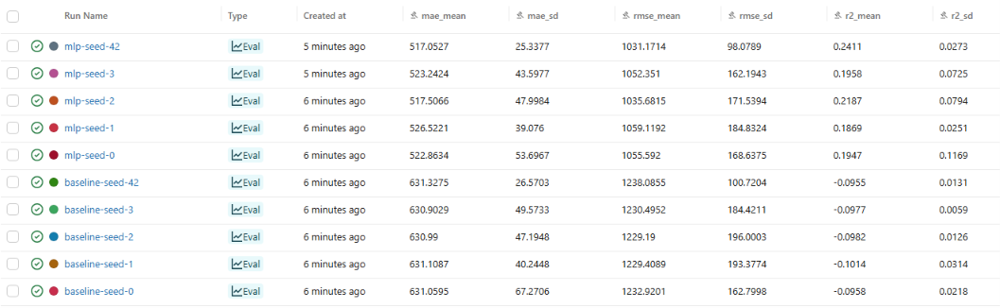

# Pipeline de ML reproducible · SentryBox

**Curso:** Machine Learning I (UCSUR, 2026-2) · **Entregable:** individual, Pipeline de ML reproducible (parte de la EC2)
**Estudiante:** Alexander Andri Yupanqui Segura · **Grupo:** 2  · **Integrante:** 6
**Algoritmo asignado:** red neuronal MLP (`MLPRegressor`, definido por el grupo; `MODELO = "mlp"`)
**Tipo de problema:** regresión · **Variable objetivo:** `ganancia_neta_mes` (S/ por mes)

## 1. Descripción del proyecto
El modelo predice la ganancia neta mensual de microcomerciantes minoristas del Perú con 16 variables de la encuesta ENAHO 2025 del INEI. El repositorio permite que cualquier persona repita el experimento y obtenga los mismos números: datos organizados por zonas (raw, processed, results), un Pipeline de scikit-learn sin fuga de datos, validación cruzada repetida con 5 semillas, registro en MLflow y versiones fijadas. Cada integrante del grupo usa el mismo dataset y la misma partición con un algoritmo distinto; este repositorio corresponde al integrante 6.

## 2. Fuente y descripción de los datos
### 2.1 Fuente original
- **Institución:** INEI, Encuesta Nacional de Hogares (ENAHO) 2025, Módulo 500 «Empleo e Ingresos».
- **Descarga:** https://proyectos.inei.gob.pe/microdatos/ (archivo `Enaho01a-2025-500.csv`).
- **Licencia:** ODbL según la ficha de la Plataforma Nacional de Datos Abiertos, verificada por el integrante de Datos del grupo. El subconjunto derivado debe conservar la atribución a la fuente original.

### 2.2 Construcción del subconjunto
El grupo filtró a personas ocupadas, empleadores o independientes, del comercio al por menor (CIIU Rev. 4, 4700 a 4799). De 84 853 encuestados quedaron 4 996; al quitar a quienes no informaron ganancia o declararon cero, quedaron 4 765 filas. Ese archivo es `data/raw/sentrybox_enaho2025.csv`.

### 2.3 Características del dataset
| Característica | Descripción |
|---|---|
| Archivo | `data/raw/sentrybox_enaho2025.csv` (281 KB) |
| Registros | 4 765 |
| Columnas | 18 (17 predictoras candidatas y el objetivo) |
| Variables predictoras usadas | 16 |
| Objetivo | `ganancia_neta_mes` (de S/ 3 a S/ 20 000; mediana S/ 457; media S/ 836) |
| Valores faltantes | 1 |
| Columna afectada | `nivel_educativo` (se imputa con la moda dentro del Pipeline) |
| Duplicados | 0 |
| Cobertura | Nacional, comercio minorista (CIIU 4700 a 4799) |
| Unidad | Soles (S/) por mes |

## 3. Variables utilizadas
### 3.1 Variable objetivo
| Variable | Descripción | Tipo |
|---|---|---|
| `ganancia_neta_mes` | Ganancia neta de la ocupación principal el mes anterior (P530A) | Numérica continua (S/) |

### 3.2 Predictoras numéricas
| Variable | Descripción |
|---|---|
| `edad` | Años cumplidos (P208A) |
| `horas_semana` | Horas trabajadas la semana pasada en la ocupación principal (P513T) |
| `anios_en_ocupacion` | Tiempo en la ocupación principal en años (P513A1 + P513A2/12) |
| `personas_en_negocio` | Personas que laboran en el negocio, incluido el encuestado (P512B) |
| `sexo_mujer` | 1 si es mujer (P207) |
| `es_empleador` | 1 empleador, 0 independiente (P507) |
| `ayuda_familiar_no_remunerado` | Lo ayudan familiares sin pago fijo (P508) |
| `lleva_libros_contables` | Lleva libros o sistema de contabilidad (P510B) |
| `tiene_ocupacion_secundaria` | Tuvo otro trabajo la semana pasada (P514) |

Las cinco variables binarias van en `COLS_NUM` (valores 0 y 1) y se escalan junto con las numéricas.

### 3.3 Predictoras categóricas
| Variable | Descripción |
|---|---|
| `estado_civil` | Estado civil, códigos 1 a 6 (P209) |
| `nivel_educativo` | Último nivel aprobado, códigos 1 a 12 (P301A) |
| `registro_sunat` | 1 persona jurídica, 2 persona natural con RUC, 3 sin RUC (P510A1) |
| `subsector_ciiu` | Actividad CIIU Rev. 4, 21 códigos de 4711 a 4799 (P506R4) |
| `dominio` | Dominio geográfico del INEI, códigos 1 a 8 |
| `estrato` | Estrato geográfico del INEI, códigos 1 a 8 |
| `mes_encuesta` | Mes de la encuesta, 1 a 12 |

`tiene_trabajadores_pagados` (P509) se excluyó: es idéntica a `es_empleador` en las 4 765 filas (correlación 1.00) y generaría colinealidad exacta. Sigue en el archivo raw, pero no está en `COLS_NUM` ni en `COLS_CAT`.

## 4. Estructura del repositorio
```text
repro-ml-yupanqui/
├── data/
│   ├── raw/sentrybox_enaho2025.csv     <- zona raw (original, nunca se edita)
│   ├── processed/dataset.csv           <- zona processed (lo genera prepare_data.py)
│   └── MANIFIESTO.md                   <- fuente, licencia, MD5 y diccionario
├── results/results_summary.csv         <- zona results (lo genera run_seeds.py)
├── docs/mlflow.png                     <- captura de la interfaz de MLflow
├── src/
│   ├── __init__.py
│   ├── config.py                       <- único archivo que se adapta al dataset
│   ├── prepare_data.py
│   ├── train.py
│   └── run_seeds.py
├── .gitattributes                      <- *.csv -text (Git no cambia los saltos de línea)
├── .gitignore
├── requirements.txt
└── README.md
```
- **RAW (bronze):** el archivo tal como lo entregó el grupo. Nunca se edita; su MD5 está en el manifiesto.
- **PROCESSED (silver):** solo lo genera `src/prepare_data.py` a partir de raw.
- **RESULTS (gold):** solo lo genera `src/run_seeds.py`.
- **Excluidos de Git:** `.venv/`, `mlflow.db`, `mlruns/` y `__pycache__/` (ver `.gitignore`).

## 5. Requisitos del entorno
| Herramienta | Versión |
|---|---|
| Python | 3.12.0 (se necesita 3.11 o superior) |
| Sistema operativo | Windows 11 (PowerShell) |
| NumPy | 2.5.4 |
| Pandas | 3.1.1 |
| Scikit-learn | 1.9.1 |
| MLflow | 3.18.0 |

El autor ejecutó todo en Windows 11 con Python 3.12.0. Los mismos números también se obtuvieron en un segundo entorno (Ubuntu 24.04 con Python 3.13.18); la única diferencia es el MD5 de `processed` por los saltos de línea (ver 7.5).

## 6. Instrucciones para reproducir
### 6.1 Windows (PowerShell)
```powershell
git clone https://github.com/hola1718U/repro-ml-yupanqui.git repro; cd repro
python -m venv .venv; .venv\Scripts\Activate.ps1
pip install -r requirements.txt
$env:PYTHONHASHSEED=0
python -m src.prepare_data
python -m src.train --seed 42
python -m src.run_seeds
```
Si PowerShell no deja activar el entorno, ejecuta una sola vez `Set-ExecutionPolicy -Scope CurrentUser RemoteSigned`.

### 6.2 macOS y Linux
```bash
git clone https://github.com/hola1718U/repro-ml-yupanqui.git repro && cd repro
python -m venv .venv && source .venv/bin/activate
pip install -r requirements.txt
PYTHONHASHSEED=0 python -m src.prepare_data
PYTHONHASHSEED=0 python -m src.train --seed 42
PYTHONHASHSEED=0 python -m src.run_seeds
```

### 6.3 Visualización en MLflow
```powershell
mlflow ui --backend-store-uri sqlite:///mlflow.db
```
Abrir http://127.0.0.1:5000.

### 6.4 Archivos generados
| Archivo | Descripción |
|---|---|
| `data/processed/dataset.csv` | Dataset limpio, generado por `src.prepare_data` |
| `results/results_summary.csv` | 10 filas: baseline y MLP por 5 semillas, generado por `src.run_seeds` |
| `mlflow.db` | Registro local de las 10 corridas (no se sube a Git) |
| `docs/mlflow.png` | Captura de la interfaz de MLflow con las 10 corridas |

## 7. Diseño experimental y reproducibilidad
### 7.1 Configuración
- **Tarea:** regresión sobre `ganancia_neta_mes`.
- **Algoritmo:** `MLPRegressor` con una capa oculta de 16 neuronas, `alpha = 1.0`, `max_iter = 2000`, entrenado sobre log(1 + ganancia) y con la predicción devuelta en soles (`expm1`).
- **Baseline:** `DummyRegressor(strategy="median")`.
- **Semillas:** 0, 1, 2, 3 y 42. **Validación cruzada:** `KFold(5, shuffle=True)` con la semilla de cada corrida.
- **Métricas:** MAE (principal), RMSE y R².

### 7.2 Partición
División 80/20 con `random_state = 42` (`SEMILLA_PARTICION`, igual para todo el grupo). El 20 % de prueba (953 filas) se aparta y no se usa en este entregable. La validación cruzada se hace solo sobre el 80 % (3 812 filas).

### 7.3 Preprocesamiento (dentro del Pipeline)
- **Numéricas (y binarias):** imputación con la mediana y `StandardScaler`.
- **Categóricas:** imputación con la moda y `OneHotEncoder(handle_unknown="ignore")`.
- Los hiperparámetros del MLP se eligieron con validación cruzada sobre el 80 %, nunca con la prueba. Una red mayor (64 y 32 neuronas, `alpha = 0.001`) sobreajustaba (MAE CV 1 108, peor que el baseline de 631).

### 7.4 Reproducibilidad
`set_seed` fija `random` y `numpy`; la red usa `random_state = seed`; los folds usan la semilla de la corrida; y `PYTHONHASHSEED=0` se define antes de iniciar Python. Tres corridas de `python -m src.train --seed 42` dan la misma salida.

### 7.5 Integridad de los datos
| Archivo | MD5 |
|---|---|
| `data/raw/sentrybox_enaho2025.csv` | `79cb9c9fcccd760795c3a28fdc8b35e3` |
| `data/processed/dataset.csv` (generado en Windows, saltos de línea CRLF) | `5caa212fdfd858bb9a4f218d43c94d8d` |
| `data/processed/dataset.csv` (generado en Linux/macOS, saltos de línea LF) | `79cb9c9fcccd760795c3a28fdc8b35e3` |

El contenido de processed es el mismo en los tres casos; solo cambia el salto de línea que pandas escribe en cada sistema (Windows escribe `\r\n`, Linux y macOS escriben `\n`), y por eso cambia el MD5. El `.gitattributes` (`*.csv -text`) evita que Git altere los saltos de línea del archivo raw al clonar, así su MD5 siempre es `79cb9c9f…`. Los resultados numéricos no dependen del salto de línea.

## 8. Resultados de los experimentos
### 8.1 Resultado esperado (`--seed 42`)
```json
{"seed": 42, "modelo": "mlp", "data_md5": "5caa212fdfd858bb9a4f218d43c94d8d", "mae_mean": 517.05272, "mae_sd": 25.33767, "rmse_mean": 1031.1714, "rmse_sd": 98.07892, "r2_mean": 0.24108, "r2_sd": 0.02726}
```

### 8.2 Resultados por semilla (`results/results_summary.csv`)
`*_sd` es la desviación entre los 5 folds de cada semilla.

| Semilla | Modelo | MAE medio | DE MAE | RMSE medio | DE RMSE | R² medio | DE R² |
|---|---|---|---|---|---|---|---|
| 0 | baseline | 631.05946 | 67.27055 | 1232.92013 | 162.79982 | -0.09580 | 0.02177 |
| 1 | baseline | 631.10871 | 40.24476 | 1229.40888 | 193.37736 | -0.10137 | 0.03142 |
| 2 | baseline | 630.98995 | 47.19475 | 1229.18997 | 196.00026 | -0.09816 | 0.01257 |
| 3 | baseline | 630.90287 | 49.57325 | 1230.49517 | 184.42108 | -0.09767 | 0.00586 |
| 42 | baseline | 631.32751 | 26.57029 | 1238.08550 | 100.72041 | -0.09552 | 0.01312 |
| 0 | mlp | 522.86337 | 53.69665 | 1055.59197 | 168.63749 | 0.19465 | 0.11691 |
| 1 | mlp | 526.52206 | 39.07598 | 1059.11919 | 184.83236 | 0.18694 | 0.02506 |
| 2 | mlp | 517.50660 | 47.99841 | 1035.68151 | 171.53942 | 0.21865 | 0.07936 |
| 3 | mlp | 523.24240 | 43.59772 | 1052.35097 | 162.19434 | 0.19576 | 0.07251 |
| 42 | mlp | 517.05272 | 25.33767 | 1031.17140 | 98.07892 | 0.24108 | 0.02726 |

### 8.3 Media y desviación entre semillas
Media ± desviación muestral (ddof = 1) de los 5 valores medios por semilla.

| Modelo | MAE (S/) | RMSE (S/) | R² |
|---|---|---|---|
| baseline | 631.08 ± 0.16 | 1232.02 ± 3.70 | -0.098 ± 0.002 |
| mlp | 521.44 ± 4.06 | 1046.78 ± 12.53 | 0.207 ± 0.022 |

**Resultado reportado:** MAE del MLP = **521.44 ± 4.06 S/** frente a **631.08 ± 0.16 S/** del baseline.

### 8.4 Interpretación
El MLP reduce el MAE en unos 110 S/ (17.4 %) respecto del baseline y lo supera en las 5 semillas (517 a 527 frente a 631). La diferencia es mucho mayor que la desviación entre semillas, pero la comparación es descriptiva: todas las semillas comparten la misma partición y no se usó el conjunto de prueba. El R² de 0.21 indica que las variables de la encuesta explican solo una parte de la ganancia.

### 8.5 Evidencia de MLflow


## 9. Qué lo hace reproducible
| Requisito | Cómo se cumple |
|---|---|
| ≥ 6 commits | Un commit por parte del entregable (`git log --oneline`), con mensajes que dicen qué se hizo en cada una. |
| Sin fuga de datos | Imputación, escalado y one-hot están dentro del `Pipeline` (`src/train.py`): en cada fold se ajustan solo con los 4 folds de entrenamiento. El 20 % de prueba se aparta con la semilla 42 y no se usa. |
| Aleatoriedad fija | `set_seed`, `random_state=seed` en la red y en los folds, `SEMILLA_PARTICION = 42` y `PYTHONHASHSEED=0` antes de lanzar Python. Tres corridas con `--seed 42` dan la misma línea JSON. |
| 5 semillas en MLflow, media ± DE | `src.run_seeds` corre baseline y MLP con las semillas 0, 1, 2, 3 y 42, registra 10 corridas en `mlflow.db` y calcula media ± DE entre semillas. |
| Mismos datos para todos | El `data_md5` de processed aparece en cada línea de salida y en MLflow; el grupo comprueba que todos tengan `5caa212fdfd858bb9a4f218d43c94d8d` (Windows) y el mismo MD5 de raw. |
| Entorno exacto | `requirements.txt` fija numpy, pandas, scikit-learn y mlflow con `==`; Python y sistema operativo están indicados en la sección 5. |

## 10. Limitaciones del modelo
1. Poder predictivo moderado: R² ≈ 0.21; las variables de encuesta no miden ubicación exacta, clientela ni capital.
2. El MLP se entrena sobre log(1 + ganancia), lo que reduce el MAE pero subestima a quienes más ganan.
3. Las cifras pueden variar levemente en otro sistema operativo o con otras versiones de las librerías (coma flotante); por eso se fijan las versiones.
4. El modelo usa la muestra nacional; la validación en Lima Metropolitana queda para la EC3.
5. `sexo_mujer` está en el modelo y reproduce la brecha de ingresos; no debe usarse tal cual para fijar líneas de crédito.
6. Los hiperparámetros se probaron con validación cruzada sobre el 80 %; no es una búsqueda exhaustiva.
7. La ganancia es autorreportada en la encuesta, por lo que puede tener error de declaración.

## 11. Preguntas de comprensión
**1. ¿Por qué el imputador y el escalador están dentro del Pipeline y no se aplican a todo el dataset antes de la validación cruzada?**
Si imputara y escalara todo el dataset antes de la validación cruzada, la mediana y la media de `edad` o `horas_semana` incluirían filas que luego caerían en el fold de validación, y el modelo "vería" información de ese fold. Dentro del Pipeline, en cada fold se calculan solo con los 4 folds de entrenamiento. Con 4 765 filas la diferencia sería pequeña, pero el MAE saldría algo optimista.

**2. ¿Por qué el 20 % de prueba no se usa en este entregable? ¿Qué pasaría con su resultado si lo usara para elegir el modelo?**
El 20 % de prueba (953 filas) se reserva para evaluar una sola vez el modelo que elija el grupo. Si yo lo usara para elegir entre baseline, MLP u otros ajustes, ese 20 % dejaría de ser independiente y mi MAE sería optimista, porque habría elegido lo que mejor le queda a esas 953 personas.

**3. ¿Qué mide la desviación estándar entre las 5 semillas y qué NO mide?**
La DE entre las 5 semillas (4.06 S/ en el MLP) mide cuánto cambia el MAE promedio cuando cambian el reparto de los folds y la inicialización de la red. No mide el error del modelo con comerciantes nuevos, ni el sesgo, ni la incertidumbre por tener 4 765 filas: todas las semillas usan la misma partición 80/20.

**4. ¿Su modelo supera al baseline en las 5 semillas? ¿La diferencia es mayor que la desviación estándar? ¿Qué concluye?**
Sí: el MLP tiene menor MAE que el baseline en las 5 semillas (de 517 a 527 frente a 631). La diferencia media es de unos 110 S/, mucho mayor que la DE del MLP (4.06) y la del baseline (0.16). Concluyo que el MLP aprende algo útil sobre la mediana de ganancia, aunque el error sigue siendo grande frente a una ganancia mediana de S/ 457.

**5. ¿Por qué el archivo de la zona raw no se modifica nunca y para qué sirve su MD5?**
El archivo raw es la evidencia de lo que entregó la fuente. Si lo edito a mano, ya no se puede saber qué cambió ni repetir el proceso. Todo cambio va en `prepare_data.py`. Su MD5 (`79cb9c9f…`) sirve para que otra persona compruebe que tiene exactamente el mismo archivo antes de comparar resultados.

**6. ¿Por qué PYTHONHASHSEED=0 debe definirse antes de iniciar Python y no dentro del script?**
Python decide la semilla de hash de los textos al arrancar, antes de ejecutar mi script. Si la defino dentro del script, ya es tarde: ese valor ya quedó fijado y puede cambiar el orden de conjuntos y diccionarios entre corridas. Por eso se define en la terminal (`PYTHONHASHSEED=0`) antes de lanzar `python`.

## 12. Prueba del extraño
- **Evaluador:** Sebastian Armando Huanuco Maldonado (cuenta de GitHub `ArmandoHuanuco-dev`). Firma el Issue como «grupo 2» (el informe lo llama Equipo 2); en el informe del grupo aparece como integrante 3, en el mismo equipo del autor.
- **Fecha:** 6 de noviembre de 2026, 21:41 (hora de Lima).
- **Entorno del evaluador:** Windows 11 (PowerShell), Python 3.13, entorno virtual nuevo creado solo con `requirements.txt`, en una carpeta vacía.
- **Qué reporta el Issue:**
  1. En una primera ejecución, Git convirtió los saltos de línea del archivo raw de LF a CRLF y su MD5 no coincidió.
  2. Después de agregar `.gitattributes` con `*.csv -text` (ya incluido en este repositorio), todos los MD5 y resultados coincidieron.
  3. Declara que la salida «coincide al 100 %» con este README e incluye las tablas de métricas del baseline y del MLP con 5 semillas.
- **Valores que deben salir:** MD5 raw `79cb9c9f…`, MD5 processed `5caa212f…` (Windows), `mae_mean` 517.05272 con `--seed 42`, baseline 631.0777 ± 0.1597 y MLP 521.4374 ± 4.0565.
- **Evidencia:** https://github.com/hola1718U/repro-ml-yupanqui/issues/1

## 13. Declaración de uso de IA
Usé Claude (Anthropic) como asistente de programación en este repositorio: preparó la estructura a partir de la plantilla, completó `src/config.py` según la EC2 del grupo, agregó el MLP a la función `estimador`, probó varias configuraciones del MLP con validación cruzada sobre el 80 %, ejecutó los scripts y redactó el borrador del manifiesto y de este README. Yo revisé el código y los números, ejecuté los comandos en mi equipo con Windows y respondo por todo el contenido. No usé otras herramientas de IA.

## 14. Autor y repositorio
- **Estudiante:** Alexander Andri Yupanqui Segura (Universidad Científica del Sur)
- **Curso y entregable:** Machine Learning I · EC2, Pipeline de ML reproducible
- **Proyecto:** SentryBox (grupo 2) · **Rol:** integrante 6, algoritmo MLP
